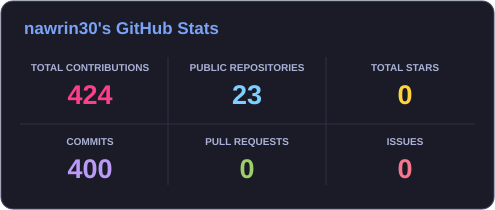
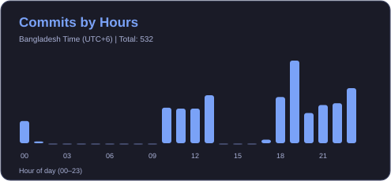
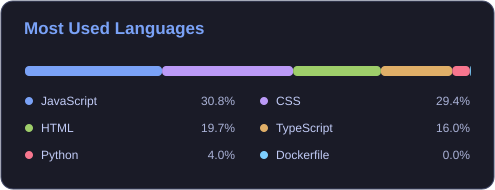
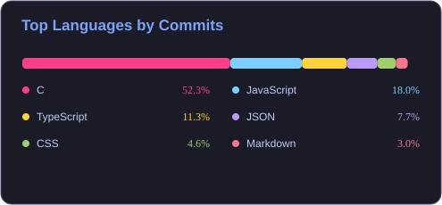
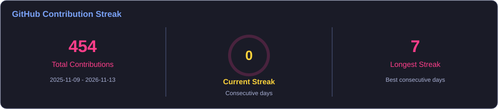

Hi, I'm Nawrin Tarannum 👋

Software Engineering Student | Aspiring Full-Stack Developer

Passionate about building modern, practical, and user-focused software solutions.

  
  
  

👩‍💻 About Me

I’m a Software Engineering student at Daffodil International University with a strong interest in software development and full-stack web development. I enjoy turning ideas into practical applications and continuously improving my skills through hands-on projects.

My current tech stack includes Java, C++, JavaScript, TypeScript, React, Node.js, and Express.js. I’m interested in building clean, responsive, and user-friendly applications while developing a strong foundation in Data Structures, Algorithms, Object-Oriented Programming, and Software Engineering principles.

I’m currently working on projects such as TaskFlow, Real-Time Communication App, and EcoMart AI. My goal is to grow as a Full-Stack Software Developer and contribute to meaningful, real-world software solutions.

🎓 Studying Software Engineering

💻 Interested in Full-Stack Web Development

🌱 Currently improving my skills in React, TypeScript & Express.js

🧠 Enjoy programming, problem solving, and building real-world applications

🚀 Focused on writing clean, maintainable, and user-friendly code

🤝 Open to collaboration, learning, and new opportunities

🛠️ Tech Stack

💻 Languages

  

🌐 Frontend

  

⚙️ Backend

  

🔧 Tools

  

<h2 align="center">🚀 Featured Projects</h2>

  A showcase of my projects and development journey.

<table>
<tr>
<td width="33%" valign="top">

<h4>📋 TaskFlow</h4>

<b>Smart Task & Project Management System</b>

A platform to organize projects, manage tasks, track progress, and improve productivity.

<b>Tech Stack:</b>

</td>
<td width="33%" valign="top">

<h4>🌦️ SkyCast</h4>

<b>Weather Forecasting App</b>

A responsive weather app providing real-time updates, temperature details, and weather information.

<b>Tech Stack:</b>

</td>
<td width="33%" valign="top">

<h4>🤖 SkillForge AI</h4>

<b>AI-Powered Learning Platform</b>

An intelligent learning platform designed to personalize learning experiences and develop new skills.

<b>Tech Stack:</b>

</td>
</tr>

<tr>
<td width="33%" valign="top">

<h4>🧘 Mindful Breathing Hub</h4>

<b>Wellness & Meditation Platform</b>

A wellness app featuring guided breathing, meditation sessions, and ambient sounds for relaxation.

<b>Tech Stack:</b>

</td>
<td width="33%" valign="top">

<h4>📖 Quran Al-Kareem</h4>

<b>Islamic Companion Website</b>

An Islamic platform to read the Holy Quran, explore Surahs, learn Duas and Dhikr.

<b>Tech Stack:</b>

</td>
<td width="33%" valign="top">

<h4>🛒 Bazar Dor</h4>

<b>Daily Essentials Price Comparison Platform</b>

A platform to browse daily essentials, explore product categories, and compare prices.

<b>Tech Stack:</b>

</td>
</tr>
</table>

📚 Currently Learning

⚛️ React & modern frontend development

🟦 TypeScript

🟢 Node.js & Express.js

🏗️ Full-Stack Web Development

🧩 Data Structures & Algorithms

💡 Software Engineering best practices

🚀 Building and deploying real-world applications

📊 GitHub Statistics

<table>
  <tr>
    <td width="50%">
      
    </td>
    <td width="50%">
      
    </td>
  </tr>
</table>

 

<h3 align="center">🔥 Top Languages by Commits (All Time)</h3>

  

🔥 GitHub Streak

📅 GitHub Contributions

## 📈 GitHub Activity

  

🏆 GitHub Trophies

  

<h2 align="center">🐍 Contribution Snake</h2>

  <picture>
    <source media="(prefers-color-scheme: dark)"
      srcset="https://raw.githubusercontent.com/nawrin30/nawrin30/output/github-contribution-grid-snake-dark.svg" />
    <source media="(prefers-color-scheme: light)"
      srcset="https://raw.githubusercontent.com/nawrin30/nawrin30/output/github-contribution-grid-snake.svg" />
    
  </picture>

🎯 Goals

🚀 Build and deploy more real-world full-stack applications

⚛️ Become highly confident with React & TypeScript

🔧 Strengthen backend development with Express.js

🧩 Improve Data Structures & Algorithms

🌐 Learn modern software architecture and best practices

🤝 Contribute to open-source projects

💼 Prepare for a successful career in software development

💡 Developer Mindset

"Build. Learn. Improve. Repeat."

I believe consistent learning, practical projects, and clean code are the foundation of becoming a better software engineer.

🤝 Let's Connect

I'm always interested in software development, web technologies, collaboration, and learning new things.

&nbsp;

  

⭐ Thanks for visiting my profile!

